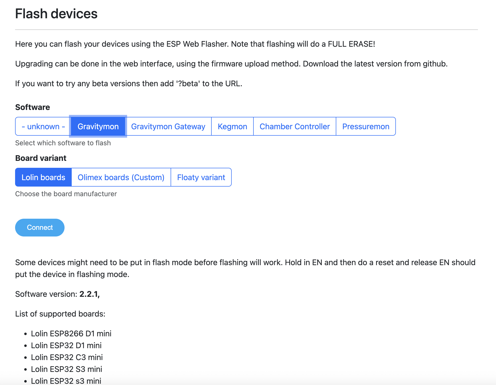

.. _installation:

Software Installation 
---------------------

Gravitymon Web Flasher
======================

This web flasher is for all my projects and this one also support configuring wifi over the serial connection. 
You will find it here: `Gravitymon WebFlasher <https://www.gravitymon.com/flasher/index.html/>`_  

Just select the software to flash and what manufacturer the board has, then the flasher will use the correct binaries. 

.. warning::

  Using the web flasher will erase the full device before flashing so make sure settings are backed up. For upgrades use
  the firmware feature in the software.

Binaries
********

In the /bin directory you will find the following firmware builds;

* **firmware.bin**

  This is the standard release build for the ESP8266.

* **firmware32c3.bin**

  This is the release build for the Lolin ESP32-C3 mini. When flashing, also use ``bootloader32c3.bin``, ``boot32c3.bin`` and ``partitions32c3.bin``.

* **firmware32s2.bin**

  This is the release build for an ESP32-S2 mini. Also flash ``bootloader32s2.bin``, ``boot32s2.bin`` and ``partitions32s2.bin``.

* **firmware32s3.bin**

  This is the release build for an ESP32-S3 mini. Also flash ``bootloader32s3.bin``, ``boot32s3.bin`` and ``partitions32s3.bin``.

* **firmware32c3zero.bin**

  This is the release build for a Waveshare ESP32-C3 Zero. Use ``partitions32c3zero.bin`` with the common C3 bootloader and boot application files.

* **firmware32c3cuckoo.bin**

  This is the release build for the Cuckoo Tilt device (ESP32-C3). Use ``partitions32c3cuckoo.bin`` with the common C3 bootloader and boot application files.

* **firmware32s3zero.bin**

  This is the release build for the Waveshare ESP32-S3 Zero. Use ``partitions32s3zero.bin`` with the common S3 bootloader and boot application files.

.. note::

  The ``bin`` directory contains release artifacts for the supported targets. Choose the matching firmware and companion boot/partition files for your board; do not mix files between targets. The source currently has a Cuckoo v2 build target, but no Cuckoo v2 release firmware is included in ``bin``.

Esptool (esp8266)
=================

The other option for flashing esp8266 device is via the official esptool. Documentation can be found 
here; `esptool home page <https://docs.espressif.com/projects/esptool/en/latest/esp32/>`_

Windows 10 should install a driver for the USB -> Serial automatically when you connect a esp8266.

The basic command for flashing an ESP8266 on Windows is;

``esptool.py --port COM4 write_flash 0x0 firmware.bin``

The basic command for flashing an ESP32C3 on Windows is;

``esptool.py --port COM6 write_flash --flash_mode dio 0x8000 .\partitions32c3.bin 0x10000 .\firmware32c3.bin``

If there are issues you can try do erase the flash first using this command;

``esptool.py --port COM4 erase_flash``

iSpindel (esp8266)
==================

If you already have the device flashed with iSpindel firmware you can go into the configuration mode where you will find
an option for updating firmware. The option is under the maintenance menu.

Select the esp8266 version of the firmware called firmware.bin and press upload. 

If you do an update this way GravityMon will notice that there is a stored configuration file and you will get the option to do a migration 
of the gravity formula and gyro calibration values so you don't need to do a new calibration. 

Updating firmware 
=================

You can use the above options for updating the firmware as well. But if you want to do updates without connecting the USB cable these 
are your options.

OTA Option
**********

You can use the OTA option by adding this URL to your configuration and when the device starts up in configuration mode it 
will check for a new version and if it finds a newer version it will do an update.

``https://gravitymon.com/firmware/``

Manual update
*************

When the device in is configuration mode you can manually update with a new firmware. Just open this URL in the web 
browser and select the firmware.bin file that corresponds to the version you want to flash. 

.. _serial_monitoring:

Serial Monitoring
=================

To check output from the device (logs) there are several tools out there. I found this simple tool in the Windows Store called ``Serial Port Monitoring``. 
Just select a baud rate of 115200, 8N1.

.. _setup_wifi:

WIFI compatibility
==================

The esp has limited wifi support and still relies on old standards so these are a few things to consider on the wifi setup.

* Don't use space in your wifi SSID or wifi password
* Only supports 2.4Ghz bands, channels must be 1-13, other channels are not supported (In 802.11 b/g/n modes)
* Channels between 20-25 Mhz bands
* SSID must be visible (hidden SSID dont work)

Source: https://www.espressif.com/sites/default/files/esp8266_wi-fi_channel_selection_guidelines.pdf

Configuring WIFI
================

When the device is flashed it will need to have WIFI configuration in order to work. If you have used other software on 
the device its possible that wifi settings already exist.

If you need to enter the WIFI setup mode after it has been configured, tap the reset button at least 3 times. Tap the reset 
button in 1-2 second intervals. Not to fast and not to slow. 

If this is not configured in the device it will create an wireless access point called `GravityMon`. The default password is `password`.

Connect to this AP and enter the SSID and password you want to use. If the web page don't open automatically you can enter the following address 
in the browser: **http://192.168.4.1**

WIFI settings can be found under Device - WIFI in the menu.

.. _setup_ip:

Finding the device adress
=========================

Once the wifi network settings have been added then the device will reboot and connect to your network. If the blue led is flashing then it's up and running and is ready to be configured. 

If your computer supports mDNS the address you saw before can be used in your web browser to connect to the device. Windows does not have the best support for mDNS so if you are having issues 
with finding the network name you can try the following:

* Check your wireless router for the IP address and use that to connect instead, for example; http://192.168.1.56
* Download an IP scanner / Port Scanner on your Windows computer or mobile device and use that to find what devices are listening on port 80.

Once you can access the user interface then proceed to the next step.
